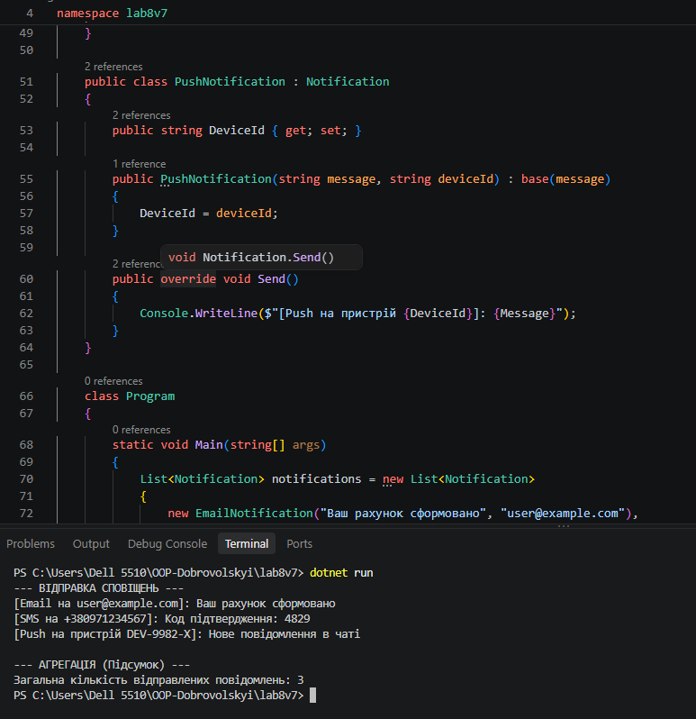

# Лабораторна робота №8 (lab8v7)

**Тема:** Поліморфізм: динамічне зв’язування та перевизначення методів  
**Варіант:** 7  

## Опис роботи
У програмі реалізовано ієрархію класів сповіщень:
- `Notification` (базовий клас із віртуальним методом `Send()`)
- `EmailNotification` (похідний клас, надсилає Email)
- `SMSNotification` (похідний клас, надсилає SMS)
- `PushNotification` (похідний клас, надсилає Push-сповіщення)

Продемонстровано поліморфізм через колекцію `List<Notification>` та виконано агрегацію результатів (підраховано загальну кількість відправлених повідомлень).

## Контрольні запитання

1. **Що таке поліморфізм і як він реалізується в C# за допомогою virtual та override?**  
   Поліморфізм — це здатність об'єктів різних класів реагувати на однаковий виклик методу по-різному. В C# він реалізується оголошенням віртуального методу з модифікатором `virtual` у базовому класі та його перевизначенням з модифікатором `override` у похідних класах.

2. **Поясніть поняття динамічного зв’язування. Чим воно відрізняється від статичного?**  
   Динамічне зв'язування вибирає конкретну реалізацію методу під час виконання програми (на основі фактичного типу об'єкта), тоді як статичне зв'язування відбувається під час компіляції (на основі оголошеного типу).

3. **Наведіть приклад, як поліморфізм дозволяє писати більш гнучкий та розширюваний код.**  
   Можна додати новий тип сповіщення (наприклад, `TelegramNotification`), просто успадкувавши `Notification` та перевизначивши `Send()`. При цьому основний цикл обробки списку повідомлень у `Main` міняти не потрібно.

4. **Які переваги дає використання колекцій базових типів для роботи з поліморфними об’єктами?**  
   Це дозволяє зберігати об'єкти різних похідних типів в одному списку та обробляти їх однотипно в одному циклі без використання складних перевірок типів.

## Результат роботи програми
